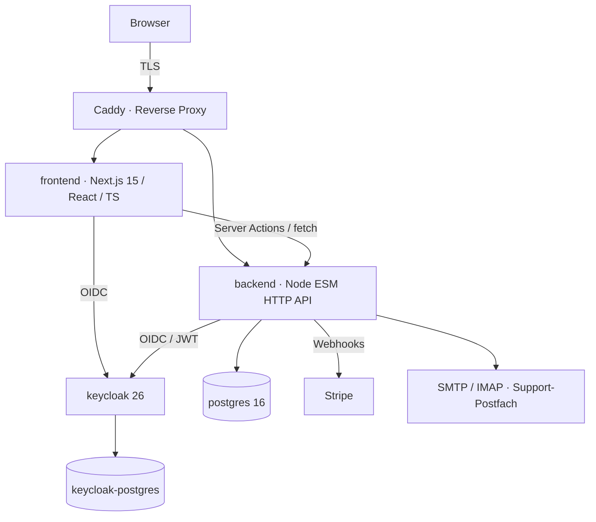

# PlatzScout — Systemarchitektur (Auszug)

PlatzScout war eine SaaS für Therapieplatz-Suche und Anbieter-Outreach. Allein gebaut und
betrieben: **~46.000 Zeilen** eigener Code (40.267 TS/TSX im Frontend, 5.368 JS im Backend),
fünf Container, zahlende Kunden, inzwischen eingestellt.

Dieses Dokument beschreibt den Aufbau. Der Produktcode (Matching, Ranking, Outreach-Strategie)
ist **nicht** öffentlich — auf Anfrage führe ich im Gespräch durch den Code.

## Container

`docker-compose.yml` orchestriert: `postgres`, `keycloak-postgres`, `keycloak`, `backend`,
`frontend` — plus ein internes Netz `platzscout_internal` und ein Volume für Rechnungs-PDFs.

## Backend (Node, ESM, ohne Framework)

| Datei | Zeilen | Aufgabe |
|---|---|---|
| `server.mjs` | 3.406 | HTTP-Router, Auth-Gate, alle Endpunkte, Stripe- und Mail-Webhooks |
| `search-matching.mjs` | 683 | Matching/Ranking der Anbieter (**privat**) |
| `pricing.mjs` | 212 | Katalog, Paket-/Add-on-Auflösung (nicht veröffentlicht) |
| `lib/stripe-webhook-idempotency.mjs` | 42 | Webhook-Statemaschine → in diesem Repo |
| `lib/search-request-workflow.mjs` | 183 | Status-Timeline einer Suchanfrage |
| `lib/users.mjs`, `lib/audit.mjs`, `lib/geo.mjs`, … | je 30–200 | Nutzer, Audit, Geocoding, PLZ, Mail |

## Frontend (Next.js App Router)

- `app/` — 26 Routen-Segmente (Registrierung, Anfrage, Admin, Partner-Portal, Rechtstexte)
- `lib/` — Domänenlogik als **reine Funktionen**: `refund-policy.ts`,
  `affiliate-commission-policy.ts`, `refund-review.ts`, `order-progress.ts`, `pricing.ts`
- `components/` — UI, getrennt von der Logik

Bewusste Entscheidung: Geld- und Statuslogik liegt in testbaren Funktionen ohne DB-Zugriff;
die Datenbank ist Projektion, nicht Wahrheit. Deshalb existieren für genau diese Teile Tests
(`node:test`, keine Test-Framework-Abhängigkeit).

## Was in diesem Repo liegt

| Datei | Zeilen |
|---|---|
| `lib/refund-policy.ts` | 292 |
| `lib/affiliate-commission-policy.ts` | 24 |
| `backend/lib/stripe-webhook-idempotency.mjs` | 42 |
| `backend/server-excerpt.mjs` | 17 |
| **Summe** | **375 von 46.000 Zeilen (0,8 %)** |

Ausgewählt nach einer Regel: nur Stellen, an denen ein Fehler Geld kostet oder einen Zustand
zerstört — und an denen man in 200 Zeilen erkennt, wie gearbeitet wird.

Nicht enthalten: `search-matching`, `server.mjs`, Outreach-Sequenzen, Prisma-Schema,
Migrationen, Kundendaten, Infrastruktur-Secrets. Auf Anfrage führe ich im Gespräch durch den Code.
